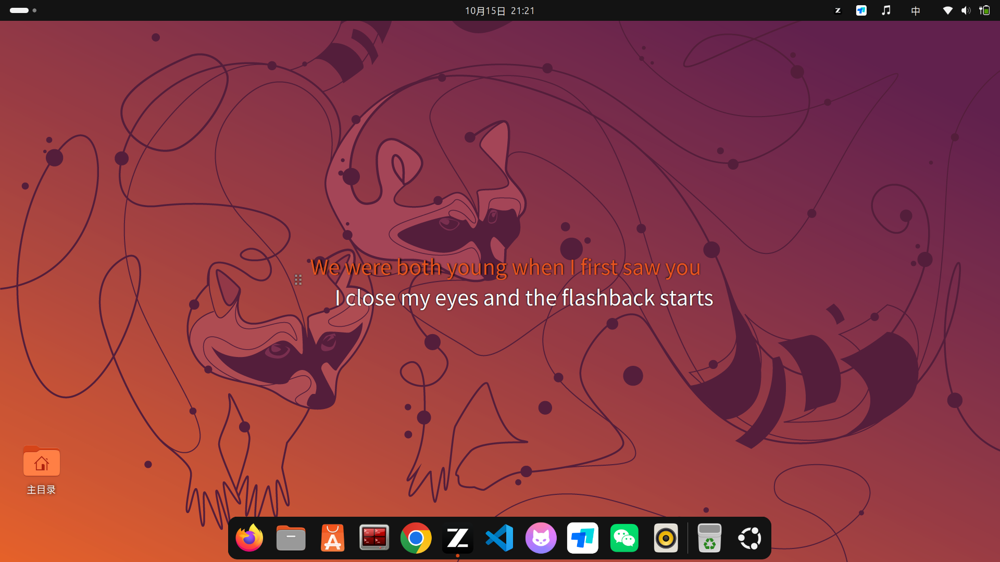
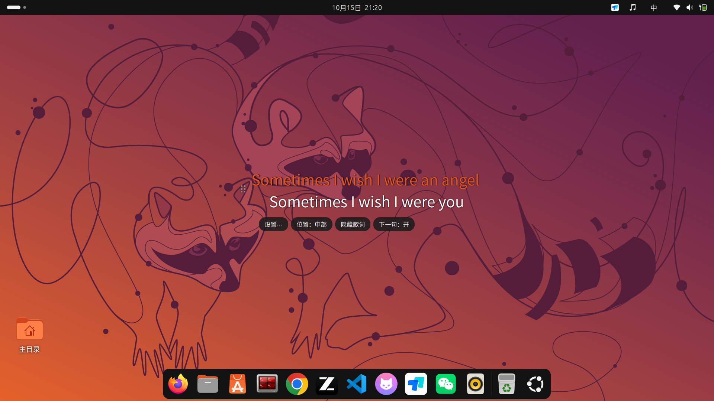

# desktop-lrc 本地桌面歌词



自写的 GNOME Shell 桌面歌词扩展，只为本地曲库服务：

- 读取歌词目录（默认 `~/Music`）中的 **`歌手 - 歌名.lrc`**，与音频同目录同名，逐行滚动显示当前句 + 下一句预览；
- 通过 MPRIS 协议跟随**任意**播放器（Rhythmbox、mpv、浏览器……），不依赖具体播放器；
- 歌词文字区域**不拦截鼠标**（可穿透点击），只有左侧 `⠿` 小手柄可交互；
- 按住 `⠿` 手柄拖动可调整位置，松手自动记住；
- 无歌词的曲目显示 `歌手 - 歌名`，不联网、不写文件。

## 安装 / 更新 / 打包

**安装**（源码方式，日常开发用）：

```bash
./install.sh
```

**标准包**（GNOME 扩展官方格式，分发/备份用）：

```bash
gnome-extensions pack desktop-lrc@kgpche --out-dir=dist
gnome-extensions install --force dist/desktop-lrc@kgpche.shell-extension.zip
```

包产物在 `dist/` 下，拷到任何 GNOME 48+ 的机器都能装。

**更新流程**：改完代码 → 重新执行 `./install.sh`（记得在 metadata.json 里递增 `version`）→ 注销重登一次。

**为什么更新代码必须注销重登**：GNOME 扩展的代码运行在 gnome-shell 进程内部，shell 只在登录时加载扩展代码，运行中不会重读磁盘文件（ReloadExtension 未实现、也不监听目录变更，均实测确认）。这是平台限制，所有手工安装的扩展相同。**设置项（颜色/字体/下一句开关等）不受影响，改动即时生效**——所以可调参数尽量都做成了设置。

## 版本历史

- v9：顶栏音乐图标总开关（隐藏状态持久化、紧凑宽度）；垂直位置三档（默认中部）；操作条移至歌词下方；完整的关闭/恢复链路
- v8：拖动改用 GNOME 官方手势配方（St.DndStartGesture + pushModal + 'event' 信号——per-type 信号与 captured-event 在 GNOME 50 上不可靠）
- v5–v7：NaN 坐标防护、Pango 离屏测量实现长句自动缩字号（替代不可靠的 CSS max-width/St 换行）、独立 GTK4 设置窗口
- v1–v4：初始版本；本地 .lrc 三级匹配；MPRIS 跟随；Ubuntu 橙默认色、错开显示；右键内嵌操作条


## 调整外观



三种入口（改动都即时生效）：

- **右键歌词 → 操作条 → 「设置…」**：独立 GTK4 设置窗口，不依赖 shell 的 prefs
  服务（部分发行版该服务损坏时依然可用）；
- **顶栏音乐图标**：歌词显示/隐藏总开关；操作条内还有位置三档与下一句开关；
- **标准入口**：`gnome-extensions prefs desktop-lrc@kgpche` 或扩展应用里的齿轮
  （需要发行版的 prefs 服务正常）。

可调项：字体与大小、当前句颜色、下一句颜色、下一句预览开关、垂直位置、恢复默认位置。

命令行方式（等效）：

```bash
export GSETTINGS_SCHEMA_DIR=~/.local/share/gnome-shell/extensions/desktop-lrc@kgpche/schemas
gsettings set org.gnome.shell.extensions.desktop-lrc font-name 'Noto Sans CJK SC 36'
gsettings set org.gnome.shell.extensions.desktop-lrc active-color '#ffd54f'
gsettings set org.gnome.shell.extensions.desktop-lrc show-next false
```

位置重置为自动（底部居中）：

```bash
gsettings set org.gnome.shell.extensions.desktop-lrc x -1
gsettings set org.gnome.shell.extensions.desktop-lrc y -1
```

## 文件匹配规则

1. 精确：`歌手 - 歌名.lrc`（多位歌手用 ` _ ` 连接，与曲库命名一致）；
2. 兜底：任何以 ` - 歌名.lrc` 结尾的文件，优先取歌手能对上的；
3. 没找到时重扫一次目录（新加入的文件无需重启）。

## 卸载

```bash
gnome-extensions disable desktop-lrc@kgpche
rm -rf ~/.local/share/gnome-shell/extensions/desktop-lrc@kgpche
```

## For English readers / EGO submission

**Desktop LRC** — local desktop lyrics for GNOME Shell 48+.

Reads `"Artist - Title.lrc"` files placed beside your music files (configurable
directory), follows **any MPRIS player** (Rhythmbox, mpv, browsers...), and shows
the current line plus a staggered next-line preview on your desktop.

Highlights: three-tier lyric matching (exact → suffix → punctuation-insensitive),
Pango-measured auto font-fit for long lines, GNOME-official gesture dragging
(`St.DndStartGesture` + `pushModal`), right-click action bar, 3 vertical presets,
a tray icon master toggle (with persistent hidden state), and a standalone GTK4
preferences window (works around the prefs-service breakage on some distros).
Pure local: no network, no writes. MIT licensed.

Install from extensions.gnome.org (search "Desktop LRC") or:

```bash
gnome-extensions install --force desktop-lrc@kgpche.shell-extension.zip
```

Submitting to EGO: register at extensions.gnome.org (GNOME GitLab SSO), then
"Upload extension" with the zip from `dist/`. One screenshot of the lyrics
over the desktop is required by the form.
